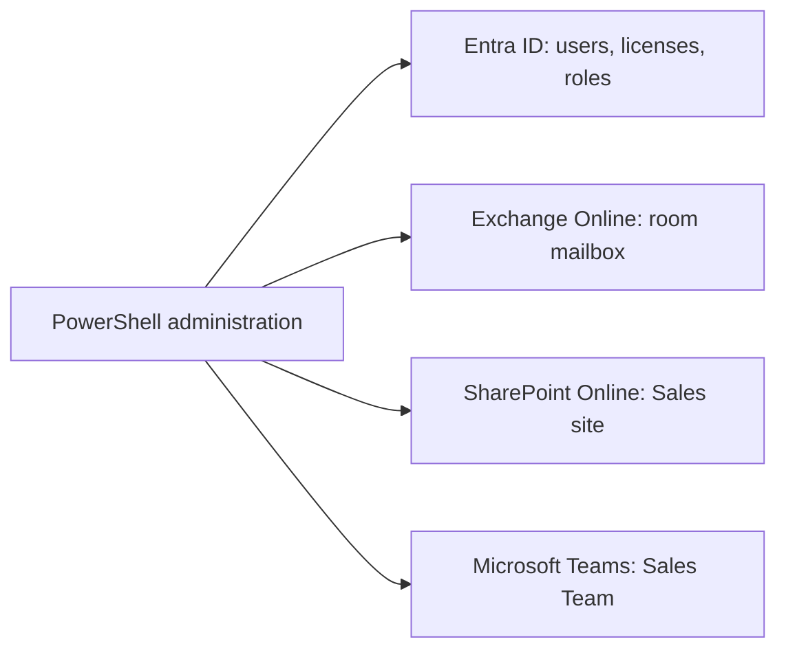
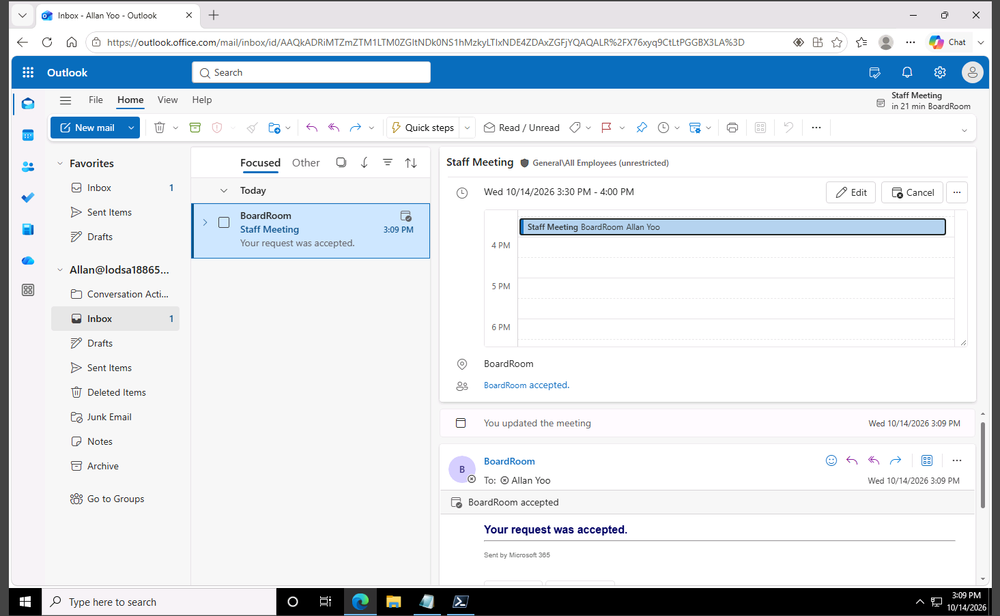
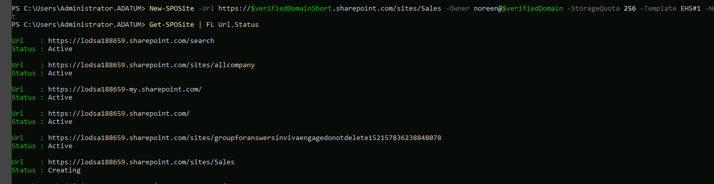
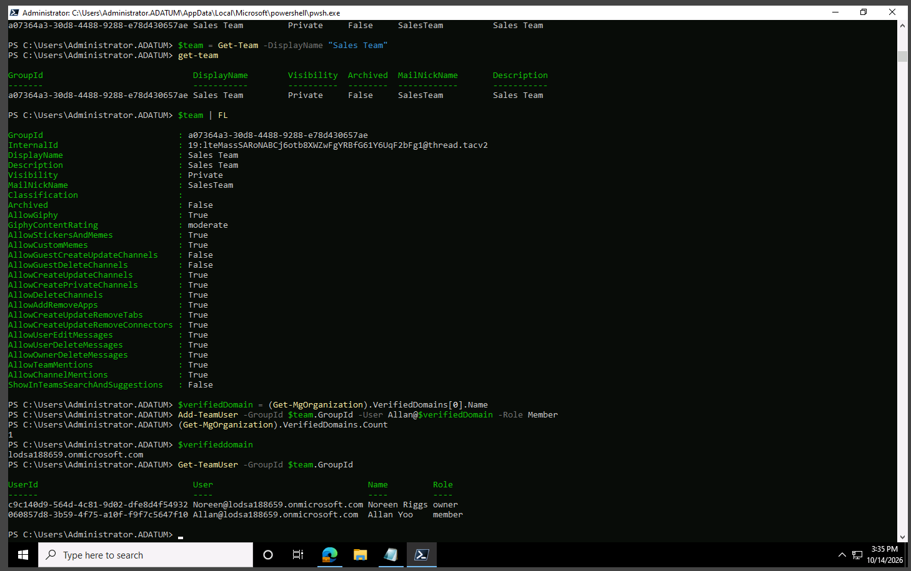

# Microsoft 365 Administration with PowerShell

**Identity, Access, and Collaboration Administration Across Microsoft 365**  
Microsoft Software & Systems Academy (MSSA) — Server and Cloud Administration


## Project Overview

I used PowerShell to administer a simulated Microsoft 365 tenant across **Microsoft Entra ID, Exchange Online, SharePoint Online, and Microsoft Teams**. The lab followed a practical onboarding scenario: create and prepare employee identities, configure a shared meeting room, start a departmental SharePoint site, and establish a Teams workspace with defined membership.

### Business Scenario

A company has recently deployed Microsoft 365 and needs a repeatable way to support its Sales department. Employees require accounts and licenses, a conference room they can book, a shared document site, and a team for communication. Configuring these separately through multiple portals creates repetitive work and makes it harder to check permissions consistently.

The objective was to practice administering these related services through PowerShell, while verifying the outcomes that could be observed in the lab. **This was a set of administrative exercises, not a finished end-to-end onboarding script.**

**Technologies:** PowerShell 7 · Microsoft Graph PowerShell SDK · Microsoft Entra ID · Exchange Online PowerShell · SharePoint Online Management Shell · Microsoft Teams PowerShell

---

## Administration Workflow



The workflow began with identity and access setup because other Microsoft 365 services depend on users, groups, and permissions. Each service required its own PowerShell connection and commands, so I checked the resulting objects instead of assuming a command had completed every downstream step.

## 1. Entra ID — Identity and Access

The first requirement was to prepare an administrative account and an employee account for Microsoft 365 services.

I connected to Microsoft Graph with delegated scopes for user, group, and directory-role administration. I created **Noreen Riggs** as an administrative user, configured a password change at initial sign-in, and used the directory role object to assign the **Global Administrator** role in the training tenant.

```powershell
$role = Get-MgDirectoryRole |
    Where-Object { $_.DisplayName -eq 'Global Administrator' }

$odataId = 'https://graph.microsoft.com/v1.0/directoryObjects/' + $user.Id
New-MgDirectoryRoleMemberByRef -DirectoryRoleId $role.Id -OdataId $odataId
```

I then created **Allan Yoo** as a standard user, configured the usage location, identified an available Office 365 E5 license SKU, and assigned the license with `Set-MgUserLicense`. I also created a Sales security group and practiced managing its membership through Microsoft Graph.

**Why it matters:** Identity, licensing, and access are prerequisites for the collaboration services configured later in the project. Using the Graph objects and their IDs also helps link dependent administrative commands accurately.

**Security consideration:** Global Administrator has extensive tenant privileges. The assignment was part of the training exercise; production environments should limit privileged accounts and follow least-privilege access practices.

*Evidence boundary:* These operations are documented in the lab notes, but I did not retain a separate screenshot confirming the final Entra ID account, license, and role assignments.

## 2. Exchange Online — Automated Room Booking

The Sales department needed a meeting room that could handle normal reservation requests without an administrator approving each one manually.

Using Exchange Online PowerShell, I created a room mailbox called `BoardRoom` and enabled automatic calendar processing:

```powershell
New-Mailbox -Room -Name BoardRoom
Set-CalendarProcessing BoardRoom -AutomateProcessing AutoAccept
```

`AutoAccept` allows Exchange Online to process requests according to the room's availability and configured booking policies. I tested the configuration by signing in as **Allan Yoo**, scheduling a **Staff Meeting** in Outlook, and including BoardRoom in the invitation.



**Verified result:** Outlook received the **“Your request was accepted”** response from BoardRoom. This confirms automatic acceptance for the tested reservation; it does not establish how every possible scheduling conflict would be handled.

The practical benefit is reducing manual coordination for routine conference-room bookings while keeping reservations visible through a shared calendar.

## 3. SharePoint Online — Sales Site Provisioning

The Sales department also needed a place for shared documents and collaboration. I connected to SharePoint Online administration, checked the available templates with `Get-SPOWebTemplate`, and started creating a departmental site.

```powershell
New-SPOSite `
    -Url "https://$verifiedDomainShort.sharepoint.com/sites/Sales" `
    -Owner "noreen@$verifiedDomain" `
    -StorageQuota 256 `
    -Template EHS#1 `
    -NoWait

Get-SPOSite | Format-List Url, Status
```

| Setting | Value |
|---|---|
| Site | Sales |
| Owner | Noreen Riggs |
| Template | `EHS#1` |
| Storage quota | 256 MB |
| Provisioning | Asynchronous (`-NoWait`) |

The `-NoWait` switch starts site creation without waiting for the full provisioning operation to finish. That makes a follow-up status check important.



**Observed result:** The Sales site appeared in the site inventory with status **`Creating`**. This verifies that provisioning was initiated and visible to the service. **An Active site, working document library, or completed permission setup was not independently verified.**

## 4. Microsoft Teams — Workspace and Membership

The final requirement was a dedicated Sales collaboration workspace with appropriate team membership.

I created a private **Sales Team**, retrieved its Microsoft 365 Group ID, and added Allan Yoo as a member:

```powershell
New-Team -DisplayName 'Sales Team' -MailNickName 'SalesTeam'
$team = Get-Team -DisplayName 'Sales Team'
Add-TeamUser -GroupId $team.GroupId -User "Allan@$verifiedDomain" -Role Member

Get-TeamUser -GroupId $team.GroupId
```

The Group ID identified the exact team to update, avoiding reliance on a display name when performing membership operations. I then retrieved the membership list to check the roles.



**Verified result:** The output showed **Noreen Riggs as Owner** and **Allan Yoo as Member**. This confirmed the team and its recorded membership roles. Separate channel creation or channel-permission changes were not part of the verified evidence.

---

## Troubleshooting and Lessons

The administrative tasks also exposed problems that would matter in a real Microsoft 365 support role.

| Issue | What I checked or learned |
|---|---|
| **SharePoint module did not load** | `Connect-SPOService` was not recognized after installation. Importing `Microsoft.Online.SharePoint.PowerShell` with `-SkipEditionCheck` allowed the workflow to continue under the PowerShell environment used in the lab. |
| **Microsoft Graph group lookup returned no ID** | A membership operation failed because the expected Group ID variable was empty. I learned to inspect returned objects and validate `.Id` properties before using them in dependent commands. |
| **Exchange could not initially resolve BoardRoom** | The room mailbox was not resolved during an earlier configuration attempt. The later Outlook acceptance confirmed that the room-booking workflow was completed, although the exact initial cause was not established. |

A recurring lesson was that installing a module, running a command, and verifying a service outcome are three different things. Cloud administration requires attention to **PowerShell edition compatibility, object identifiers, resource availability, and service-specific checks**.

## Results and Operational Value

| Area | Outcome supported by the lab |
|---|---|
| Entra ID | User, role, group, and license administration practiced through Microsoft Graph; no separate final-state screenshot retained |
| Exchange Online | BoardRoom automatically accepted a test meeting |
| SharePoint Online | Sales site creation initiated; last captured status was `Creating` |
| Microsoft Teams | Sales Team created; owner and member roles verified |

The project demonstrated how PowerShell can administer several connected Microsoft 365 services instead of treating identity, scheduling, document sites, and collaboration as unrelated tasks. The potential operational value is more consistent provisioning and fewer repeated portal operations. **I did not build or measure a production onboarding automation workflow.**

## What I Took Away

The most useful part of this project was learning how Microsoft 365 administration connects across services. Entra ID establishes the identities and permissions; Exchange manages shared scheduling resources; SharePoint provides departmental sites; and Teams manages collaboration membership.

I also learned to distinguish **starting an operation** from **confirming its result**. BoardRoom acceptance and Teams membership were verified directly, while the SharePoint evidence only demonstrated an in-progress site. That distinction makes technical documentation more reliable.

**Skills practiced:** Microsoft Graph PowerShell · Microsoft Entra ID · User Provisioning · Licensing · Directory Roles · Exchange Online · Resource Mailboxes · SharePoint Online · Teams PowerShell · Access Management · PowerShell Troubleshooting